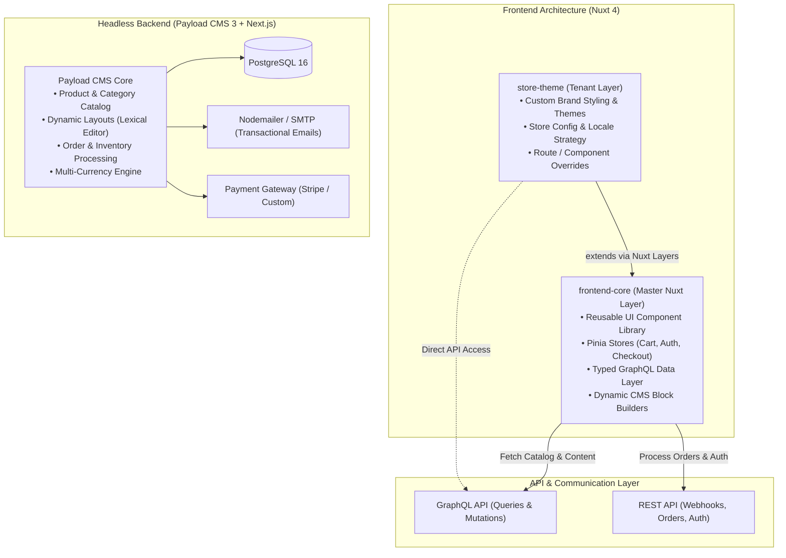
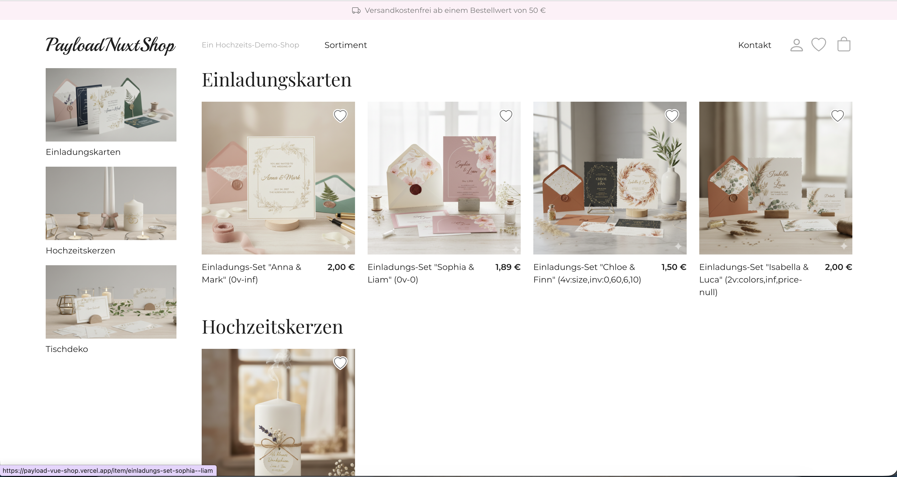
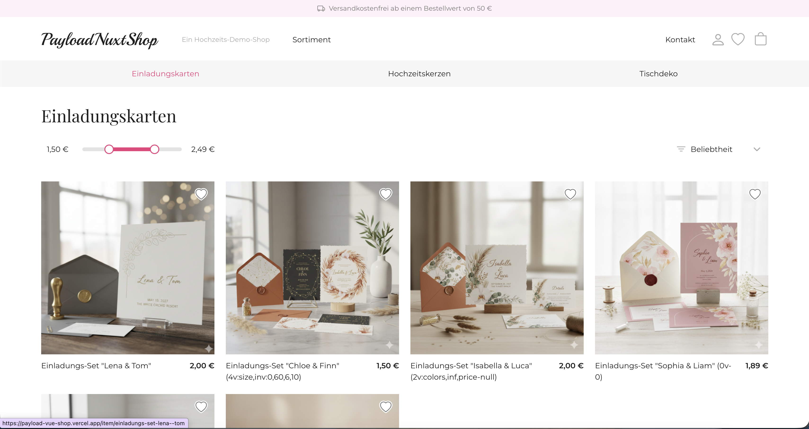
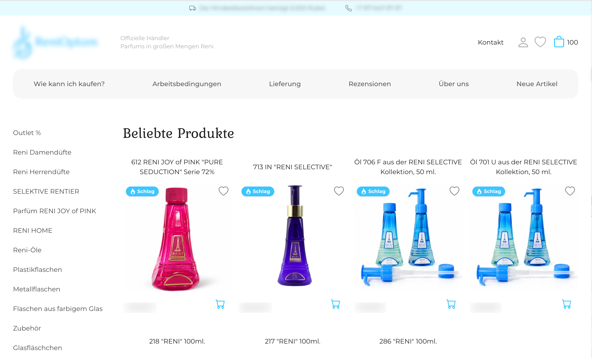
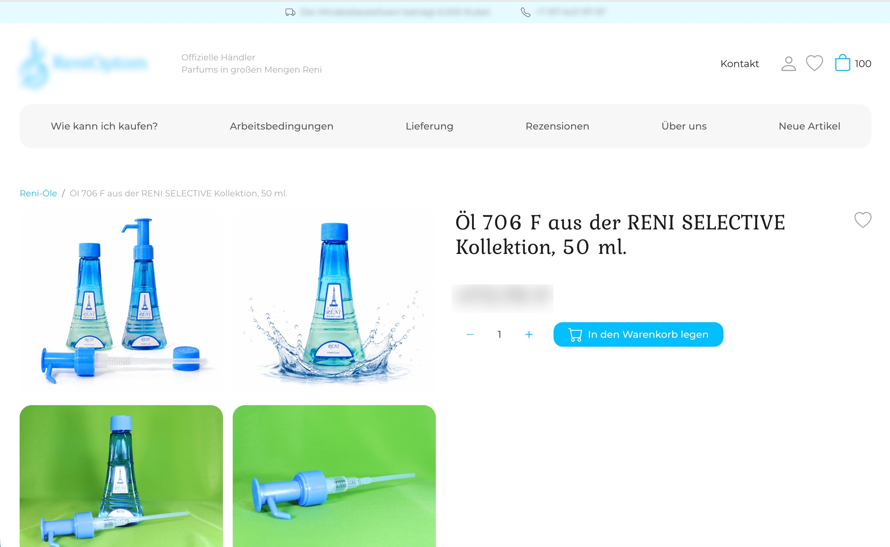
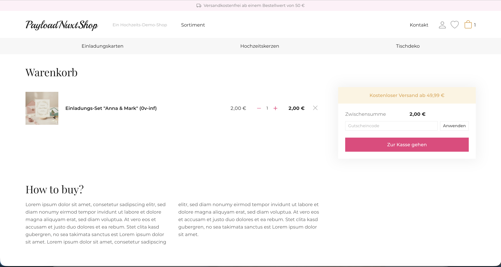
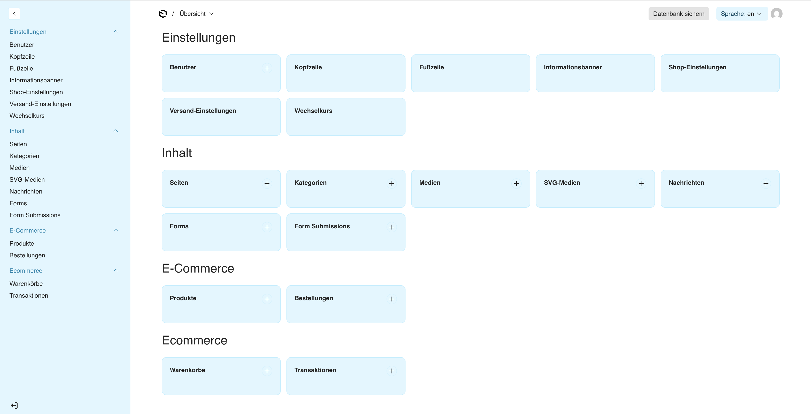
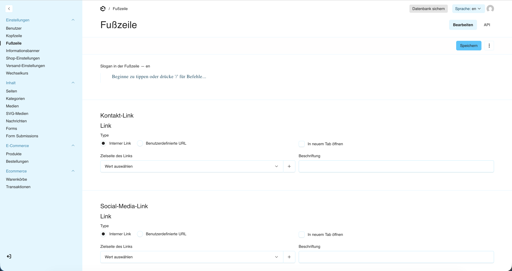

# Modern Headless Multi-Tenant E-commerce Platform

A scalable, production-grade e-commerce monorepo showcasing a **Headless E-commerce Architecture** powered by **Nuxt 4 Layers**, **Payload CMS 3 (Next.js)**, and **PostgreSQL**.

---

## 🌟 Architectural Overview

This platform implements a **White-Label Multi-Storefront Architecture**. It enables deploying and managing multiple branded web shops from a centralized codebase while maintaining complete isolation between tenants and maximizing code reuse.



---

## 📸 Screenshots & Showcase

### Storefront (Nuxt 4)

#### Storefront Homepage


#### Product Catalog & Dynamic Filtering


#### Multi-Tenant Theming & Product Grid


#### Product Detail Page


#### Shopping Cart & Checkout Flow


### Headless Management (Payload CMS 3)

#### Admin Dashboard & Collections Overview


#### Dynamic Content & Layout Management (Globals Editor)


---

## 🏗️ Repository Structure

```
ecommerce-platform/
├── backend/               # Headless CMS & E-commerce API (Payload CMS 3 + Next.js)
│   ├── src/
│   │   ├── collections/   # Pages, Products, Categories, Orders, Users, Media
│   │   ├── globals/       # Shop Settings, Header, Footer, Information Banners
│   │   ├── endpoints/     # Custom REST Endpoints (Orders, Captcha, Auth, Currency)
│   │   ├── emails/        # Transactional HTML Email Templates & Unit Tests
│   │   ├── lib/           # Money math, Captcha verification, Exchange rate logic
│   │   └── plugins/       # SEO, Form Builder, E-commerce plugins
│   ├── scripts/           # DB Seeding (seed-base.ts) & Multi-store profiles
│   └── docs/              # Technical documentation & environment specs
│
├── frontend-core/         # Master Nuxt 4 Layer (Central storefront engine)
│   ├── app/
│   │   ├── components/    # Reusable UI (Cart, Catalog, Gallery, Checkout, Blocks)
│   │   ├── composables/   # Data fetching hooks & business logic
│   │   ├── stores/        # Pinia reactive stores (Cart, Checkout, Favorites, User)
│   │   ├── pages/         # Dynamic SSR routes ([slug], category, item, payment)
│   │   └── graphql/       # GraphQL queries with automatic type generation
│   └── i18n/locales/      # Multi-language translation dictionaries (de, en, fr, ru)
│
├── store-theme/           # Branded Tenant Storefront (Child Nuxt Layer)
│   ├── nuxt.config.ts     # Extends ../frontend-core with tenant-specific options
│   └── app/               # Brand CSS variables, localized configs & overrides
│
└── docker-compose.yml     # Local PostgreSQL service definition
```

---

## 🚀 Key Technical Highlights

### 1. Nuxt 4 Layers Inheritance (DRY Storefronts)
Instead of maintaining separate frontends or copying boilerplates for every client, the storefront leverages **Nuxt 4 Layers**:
- `frontend-core` encapsulates 95% of application complexity: layouts, SEO meta tags, Pinia state stores, localized routing, and GraphQL queries.
- `store-theme` inherits the entire frontend core via `extends: ['../frontend-core']`, allowing tenant customization by simply overriding CSS tokens, site configuration, or individual templates where needed.

### 2. End-to-End Type Safety with GraphQL Codegen
- Payload CMS automatically exposes GraphQL schema types.
- Frontend uses `@graphql-codegen/cli` to compile queries into strictly typed TypeScript interfaces and response schemas.

### 3. Modular CMS Block Builder (Lexical)
- Content managers can compose rich landing pages, marketing banners, and forms without developer involvement.
- The frontend dynamically maps CMS block configurations directly to Vue components (`FormBlock`, `RawHtmlBlock`, `RichText`, `ConversionBoxes`).

### 4. Enterprise E-Commerce Capabilities
- **Multi-Currency Calculation:** Dynamic conversion between EUR, USD, and local currencies with non-destructive rounding.
- **Inventory Tracking:** Real-time stock badge states and validation during checkout.
- **Modular Payment Adapters:** Support for Stripe Checkout sessions, server-side webhooks, and invoice/manual order processing.
- **Transactional Email System:** HTML & plain-text responsive email notifications with built-in unit test suites.
- **Security & Anti-Abuse:** Server-side invisible CAPTCHA verification (Google reCAPTCHA v3 / Yandex SmartCaptcha) for user registration, checkout, and contact forms.

---

## 🛠️ Local Development Quickstart

### Prerequisites
- Node.js 20+ (recommended Node.js 22 LTS)
- Docker & Docker Compose
- npm 10+

### 1. Start Database
```bash
# Start PostgreSQL 16 container
docker compose up -d
```

### 2. Start Backend (Payload CMS 3)
```bash
cd backend

# Copy environment variables
cp .env.example .env

# Install dependencies
npm install

# Seed baseline database with system pages (About, Delivery, Contacts, etc.)
npm run seed

# Start Payload CMS dev server (runs on http://localhost:3000)
npm run dev
```
- **Admin Panel:** `http://localhost:3000/admin`
- **GraphQL Endpoint:** `http://localhost:3000/api/graphql`

### 3. Start Frontend Core or Store Theme
To run the **Core storefront**:
```bash
cd ../frontend-core
cp .env.example .env
npm install
npm run dev
# Accessible on http://localhost:3001
```

Or run the **Child Theme storefront**:
```bash
cd ../store-theme
cp .env.example .env
npm install
npm run dev
# Accessible on http://localhost:3002
```

---

## 🧪 Testing & Code Quality

Both projects enforce rigorous automated verification:

```bash
# Backend unit tests (order processing, currency math, captcha, email rendering)
cd backend && npm test

# Backend linting & format checks
cd backend && npm run check

# Frontend quality suite (prettier, eslint, vitest, typecheck)
cd frontend-core && npm run check
```

---

## 📄 License
MIT License. Built as an open-source enterprise demonstration platform.
